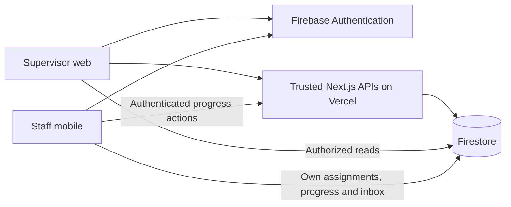

# SAID Ops — INSY7315 Task 2, Group 11

SAID Ops supports staff scheduling and daily operational work for the Society for Animals in Distress. The integrated system uses Firebase Authentication, Firestore, trusted Next.js APIs on Vercel (Firebase Spark compatible). Supervisors manage planning through the web app; staff read their own published duties, record task progress and receive persistent in-app notifications through the mobile app.

## Live Assessment Access

The supervisor web application is deployed and live. Production authentication, supervisor workforce loading and Firestore integration work. Trusted server-side API routing was repaired and verified through successful live duty-template creation.

This is an assessment/demo account. Rotate the credentials or remove the account after assessment. Further access and setup details are retained below.

**Supervisor Web Application:** [https://web-app-psi-livid.vercel.app](https://web-app-psi-livid.vercel.app)

**Supervisor Employee ID:** `ADMIN001`

**Assessment Password:** `12345678`

### Mobile Application Build Status

**Android assessment APK:** [EAS build page](https://expo.dev/accounts/script-sync/projects/said-ops-staff/builds/e950d463-c0a9-4935-afb6-521ab48a0f9a)

**Mobile assessment account:**

- **Employee ID:** `STAFF001`
- **Password:** `12345678`

The Android internal-distribution APK build completed successfully and was installed on a physical Android device. Production authentication was verified using the `STAFF001` assessment account. The mobile application connects to the production Firebase backend. These checks do not establish exhaustive mobile workflow testing.

The complete React Native / Expo mobile source code, EAS configuration, assessment build profile, Firebase integration/configuration code and production setup instructions are included in the repository for review. Production Firebase values are supplied through environment variables as described in the setup sections below.

This is an assessment/demo account. Rotate the credentials or remove the account after assessment.

**EAS Build ID:** `e950d463-c0a9-4935-afb6-521ab48a0f9a`

See [release certification](docs/RELEASE_CERTIFICATION.md), [capability audit](docs/FINAL_CAPABILITY_AUDIT.md), [deployment actions](docs/RELEASE_PIPELINE.md) and [lecturer access plan](docs/LECTURER_ACCESS.md); earlier deployment placeholders in those documents are historical. Local/emulator certification does not establish exhaustive production testing or complete academic compliance.


## Applications and architecture

| Component | Responsibility | Technology / delivery |
| --- | --- | --- |
| Supervisor web | Workforce operational fields, availability/skills, areas, reusable templates, dated roster planning, assignments, trusted publication, monitoring, history and archive | Next.js 15.5.27, React 19.1.1, TypeScript; Vercel |
| Staff mobile | Employee ID login, personal published roster, instructions/safe team, Start/Complete/Unable/Reopen, own historical work and notifications | Expo 54.0.37, React Native 0.81.5, React 19.1.0, TypeScript; EAS internal Android APK |
| Authentication | UID-backed accounts; exact staff/supervisor roles; restored sessions | Firebase Authentication |
| Operational database | Shared records, immutable publication snapshots, per-assignee progress and recipient inboxes | Cloud Firestore and rules |
| Trusted HTTP logic | Supervisor authorization, operational edits, publication validation and archive transactions | Next.js Node server routes with Firebase Admin 14.5.0 |
| Trusted progress and inbox writes | Staff transitions, safe actor history and deterministic persistent notifications in authoritative transactions | Existing Next.js Node API with Firebase Admin 14.5.0 |



Vercel hosts both Next.js pages and trusted APIs; Firebase Spark hosts Auth and Firestore. No Firebase billing or payment method is required. This reconciles older Firebase Hosting and Functions-only descriptions. Firebase Cloud Messaging/background push is deferred; this release implements persistent in-app delivery. There is no direct ezyVet integration.

## Prerequisites and repository structure

Use **Node 22.23.3 / npm 10.9.9**, Git, and Java 21 for emulator tests. The tested Firebase CLI is **15.25.0**. Preserve lockfiles and run `npm ci`; npm 11 is not the certified web installation toolchain. Expo Go or an SDK-54-compatible development client supports local mobile testing.

```text
SAID Ops/web-app/       supervisor Next.js app and trusted API handlers
SAID Ops/mobile-app/    staff Expo app
functions/             retired Stage 7C/7D source and historical tests
security-tests/        193-test baseline (direct progress writes now denied) and additional rules tests
scripts/               deterministic gates, probes and isolated emulator runners
firestore.rules        canonical authorization policy
firestore.indexes.json indexes for implemented queries
firebase*.json         backend deployment and local emulator configuration
docs/                  contracts, stage evidence and release/setup plans
INSY7315_Task1_Source_of_Truth.pdf  operational requirement authority
```

The Task 2 module manual/rubric is available in the development evidence at `../insy7315_mm.pdf`; it is not copied into this source repository. The Source of Truth and agreed integration contracts take priority over speculative extensions. Older Stage 3–6 documents are historical records; use this README and final certification for current capability.

## Locked local setup

From the repository root:

```sh
npm ci --prefix "SAID Ops/web-app"
npm ci --prefix "SAID Ops/mobile-app"
npm ci --prefix security-tests
npm install --global firebase-tools@15.25.0
```

Copy web `.env.example` to ignored `.env.local` and mobile `.env.example` to ignored `.env`. Add the appropriate public Firebase configuration. Operational passwords, Admin credentials and private keys must stay out of source and public-prefixed variables. The group-approved assessment-only login is documented below.

Start web from `SAID Ops/web-app` with `npm run dev`, then open `http://localhost:3000`. Start mobile from `SAID Ops/mobile-app` with `npm run dev`; connect Expo Go/development client. Valid role/profile-backed Employee ID accounts are required. Firebase configuration alone does not switch fixture workflows into live mode.

## Firebase emulator walkthrough

Use disposable **demo-said-5ce3e**, never a production project. `firebase.emulators.json` exposes Auth/Firestore to a development phone; use a trusted local network. Automated gates allocate separate loopback ports and do not reset manual fixtures.

Terminal 1, repository root:

```sh
firebase emulators:start --config firebase.emulators.json --only auth,firestore --project demo-said-5ce3e
```

Terminal 2, PowerShell, repository root:

```powershell
$env:SAID_EMULATOR_PROVISION='true'
$env:GCLOUD_PROJECT='demo-said-5ce3e'
$env:FIREBASE_AUTH_EMULATOR_HOST='127.0.0.1:9099'
$env:FIRESTORE_EMULATOR_HOST='127.0.0.1:8080'
# Set SAID_E2E_TEST_PASSWORD privately to a disposable test password; do not commit it.
node scripts/provision-emulator-e2e.cjs
```

The fixture writer creates ADMIN001, STAFF001 and STAFF002, actual Auth UIDs, role/profile records, operational areas and templates. STAFF002 starts inactive/Training; use the trusted workforce screen to prepare the desired test scenario. A fixture rerun updates only its named fixtures and passwords. It does not publish a roster. See [Stage 6A](docs/STAGE_6A_EMULATOR_FOUNDATION.md) for detailed routing/provisioning and [Stage 7A](docs/STAGE_7A_DURABLE_PLANNING.md) for durable profiles/templates.

Set both client projects to demo-said-5ce3e, emulator flags true and explicit Auth URL/Firestore host/port. Web uses loopback; a physical phone uses the reachable development-machine LAN address. Server Admin emulator settings must remain explicit loopback. Restart servers/reload clients after changing configuration.

Run the Next web server alongside Auth/Firestore for live progress and notifications. Set mobile `EXPO_PUBLIC_API_BASE_URL` to the development machine web origin (LAN address for a phone). HTTP is accepted only with explicit emulator mode. No Functions emulator is needed.

## Backend modes and environment

| Purpose | Web | Mobile |
| --- | --- | --- |
| Firebase public identifiers | Six `NEXT_PUBLIC_FIREBASE_*` values | Six `EXPO_PUBLIC_FIREBASE_*` values |
| Published roster / durable planning | `NEXT_PUBLIC_ROSTER_BACKEND=firestore` | `EXPO_PUBLIC_ROSTER_BACKEND=firestore` |
| Genuine monitoring / notifications | `NEXT_PUBLIC_MONITORING_BACKEND=firestore` | `EXPO_PUBLIC_MONITORING_BACKEND=firestore` |
| Explicit fixture/demo option | roster `fixture`, monitoring `memory` | roster `fixture`, notifications `memory` |
| Client emulator opt-in | `NEXT_PUBLIC_FIREBASE_EMULATORS_ENABLED=true` plus three endpoint fields | `EXPO_PUBLIC_FIREBASE_EMULATORS_ENABLED=true` plus three endpoint fields |

The six public suffixes are `API_KEY`, `AUTH_DOMAIN`, `PROJECT_ID`, `STORAGE_BUCKET`, `MESSAGING_SENDER_ID`, `APP_ID`. Emulator endpoint suffixes are `AUTH_EMULATOR_URL`, `FIRESTORE_EMULATOR_HOST`, `FIRESTORE_EMULATOR_PORT`. Client config is bundled public data, not an Admin secret.

Web's server uses `SAID_ROSTER_BACKEND=firestore`, `SAID_FIREBASE_PROJECT_ID` matching the client, and either ADC/`GOOGLE_APPLICATION_CREDENTIALS` or **server-only** `SAID_FIREBASE_SERVICE_ACCOUNT_JSON`. Local server emulator mode additionally requires `SAID_FIREBASE_EMULATORS_ENABLED=true`, `FIREBASE_AUTH_EMULATOR_HOST` and `FIRESTORE_EMULATOR_HOST`; only the fixed demo project and loopback hosts are accepted. Normal production leaves emulator variables unset (explicit false opt-out is also accepted), with no endpoints. Mobile additionally requires `EXPO_PUBLIC_API_BASE_URL` set to the deployed trusted HTTPS web origin listed under Live Assessment Access. Server credentials are never included in these examples.

Live source failures show loading/error states and clear prior account data; they do not fall back to fixtures. Explicit Refresh shows last-refreshed time. Monitoring uses Johannesburg dates/times and distinct published duty counts. Local unpublished planner edits remain session-only; templates, workforce, published work and progress persist.

## Data model and main workflows

| Path | Contract |
| --- | --- |
| `roles/{roleId}` | Exact `Supervisor/Administrator` or `Staff Member` role name |
| `employees/{uid}` | Auth UID document key; human Employee ID, safe profile and authoritative operational fields |
| `locations/{id}` | Shared operational area and active state |
| `dutyTemplates/{id}` | Reusable instructions, recurrence, staffing, skills, priority and independent critical flag |
| `publishedRosters/{monday}` | Current immutable-version pointer, verified publication metadata and optional archive metadata |
| `publishedRosters/{monday}/versions/{version}/items/{scheduledWorkId}` | Immutable dated work, instructions, UID assignments and safe team projection |
| `employees/{uid}/taskProgress/{scheduledWorkId}` | Own current status/reason/timestamp; stable occurrence identity survives republish |
| `operationalEvents/{eventId}` | Trusted create-only publication, assignment, progress and archive history |
| `notificationJobs/{jobId}` | Historical Stage 7D only; no active runtime writes; client access remains denied |
| `employees/{uid}/notifications/{id}` | Persistent recipient inbox; deterministic ID and recipient-owned `isRead` |

Supervisors update provisioned workforce operational fields and reusable templates, create/generate/copy dated work, assign staff, review coverage/conflicts and publish through the trusted API. Validation uses authoritative identity, availability, area, skills and staffing facts and rechecks them before switching the pointer. Explicit Publish Anyway permits reviewed coverage gaps; it cannot bypass invalid identities, inactive areas, unavailable assignments or overlap conflicts. Complete snapshots are created before the current pointer changes. Rejected publication never creates a false committed publication event.

Staff see only assigned current work, save Start → In Progress → Completed/Unable to Complete, and may Reopen into In Progress. Unable requires a reason; earlier reasons survive reopening. The four persisted FR-9 statuses are **Scheduled, In Progress, Completed, Unable to Complete**. Pause/checklists remain local UI state.

Publication, changed assignments, Unable and uncovered critical publication conditions feed transactionally created persistent notifications. Retry cannot duplicate an inbox item or reset its read state. Supervisors monitor real work, progress, availability and exceptions with date/area/employee/status filters. Historical views retain the last published snapshot and existing progress. Archive is a trusted, attributed, permanent read-only transition; active views exclude it and the trusted API rejects further progress actions. Staff select Include archived rosters to read their own assigned historical work. Superseded versions remain supervisor-readable; this minimal history UI shows the retained current pointer.

## Security model

Employee ID is a human login ID; it is never the Firebase UID. Firebase uses a synthetic internal Auth alias, separate from real contact email. Ordinary clients cannot grant roles, create employee identities, write publication snapshots/events/jobs or forge inbox content. Supervisor APIs verify token revocation and authoritative roles; rules protect direct client access. Staff submit permitted progress transitions to `POST /api/mobile/task-progress`; all direct client progress writes are denied. Staff may read their own progress and update notification `isRead`. Team projections omit profile contacts/auth fields. Generation/session checks clear data and ignore late callbacks after account switches.

All original negative security tests are preserved. Progress actors are derived from verified Firebase ID tokens and authoritative profiles inside the Next transaction. The retired trigger implementation and Stage 7C/7D evidence remain historical records. The dependency baseline has documented residual advisory constraints; it is not represented as vulnerability-free.

## Tests, CI/CD and production setup

```sh
npm run lint --prefix "SAID Ops/web-app"
npm run build --prefix "SAID Ops/web-app"
npm run typecheck --prefix "SAID Ops/mobile-app"
# From mobile app: npx --no-install expo config --type public
node scripts/run-release-gates.cjs deterministic
node scripts/run-release-gates.cjs rules
node scripts/run-release-gates.cjs integration
```

The final certification records exact totals and logs. Stage 7G passed **734 countable tests**, plus WS probes and static checks. The final runner additionally includes the existing WS2 roster-final assertions (which include milestones 3/4). Security retains **193 original + 42 additional rules tests**. The current Spark gate exercises an actual Next HTTP server with Auth/Firestore emulators, including durable history/inbox delivery. Original direct-write positives are replaced by denials; no tests were silently removed.

GitHub Actions validates feature pushes, integration/final, development, main and their integration/release PRs. Heavier emulator gates cover backend/security/release changes. All release checks must succeed before protected delivery jobs can deploy Firebase rules/indexes, Vercel web/API and conditional EAS APK builds. Development targets staging, main targets production; the Spark migration synchronizes the exact tested commit across all three release branches. Vercel independent Git deployment is disabled by repository config and must be verified in project setup. Delivery remains disabled until `DEPLOYMENTS_ENABLED=true` is intentionally configured.

Required GitHub environment secrets: **FIREBASE_PROJECT_ID, FIREBASE_SERVICE_ACCOUNT_JSON, VERCEL_TOKEN, VERCEL_ORG_ID, VERCEL_PROJECT_ID, EXPO_TOKEN**. Use separate staging/production projects and secrets. Follow the [exact Firebase/Vercel/EAS/GitHub setup actions](docs/RELEASE_PIPELINE.md). Internal Android command after project/package/signing/env setup: `npx eas-cli@24.10.0 build --platform android --profile assessment --non-interactive`. The completed assessment APK build link and verified physical-device installation and production login are documented near the top of this README.

## Live Assessment Access

| Assessment access | Value |
| --- | --- |
| Supervisor Web Application | [SAID Ops supervisor application](https://web-app-psi-livid.vercel.app) |
| Supervisor Employee ID | `ADMIN001` |
| Assessment Password | `12345678` |
| Firebase project | `said-ops` |

This is the group-approved assessment/demo account. Sign in with the Employee ID and password above. Staff/mobile assessment credentials and the completed APK build link are documented in the Mobile Application Build Status subsection near the top of this README. Rotate the password or remove the assessment account after marking. No service-account JSON, private keys, ID tokens, Vercel/EAS secrets or keystore credentials are included.

The earlier ADMINDEMO/STAFFDEMO provisioning plan in [Lecturer access](docs/LECTURER_ACCESS.md) is a historical proposal. Use the actual assessment identity above; authorized administrators still manage Auth accounts and UID-keyed workforce profiles.

## Assessment demonstration

Suggested presentation: explain the role split/security model; show durable workforce/availability and a template; create shared and critical work; demonstrate validation and coverage confirmation; publish; show personal mobile assignments and persistent notifications; execute Start/Complete/Unable/Reopen and refresh genuine monitoring; reassign/republish with retained progress; search history and archive a disposable completed week; show passing checks and, after setup, the real deployment run and installable APK. Explain genuine limits and architecture reconciliation. Presentation delivery/attendance and ARC submission remain human evidence.

## Known limitations and deferred scope

Unpublished drafts have no recovery/save-draft store. Leave-related availability persists, but leave-request/approval workflow is deferred. Mobile profile/contact edits remain partly session/demo data. Durable contextual notes, structured outreach vehicle/equipment/route preparation, time-scheduled approaching/overdue notifications and targeted urgent-notice authoring remain partial. Overdue exceptions are visible when supervisors refresh. There is no FCM/background delivery, enterprise audit search, fleet/resource subsystem, route optimization, advanced analytics, app-store submission or ezyVet integration.

Historic staff reads cover their assignment in each week's retained current pointer, including archives; they do not expose superseded versions. Mobile history offers week/day selection and duty opening; full duty/area/status history search and displayed completion timestamps remain partial. Full accessibility/device breadth, broader mobile workflow testing, production recovery/backup rehearsal and hosted performance/security smoke tests remain pending. See the [capability audit](docs/FINAL_CAPABILITY_AUDIT.md) for academic implications; deferral does not mean a rubric exemption.

## Code Attribution and References

These references document external APIs and patterns that correspond to the implementation inspected for submission. Inline comments identify the relevant sections; they do not claim verbatim copying or exclusive authorship of shared integration files. Team names identify the contribution workstream. Git history supports the original areas, including Nyiko's platform/security commit `350faea`, Ndivhuwo's monitoring commit `809585a`, Tival's access/location commits `0dd0da1` and `8c46582`, Junior's synchronous task-save lock `17cf756`, and Aaryan's printing/publication/week-restoration commits `d3465bc`, `bb4f5cb` and `345d0f4`.

| Member | Verified implementation and source placement |
| --- | --- |
| Nyiko Masinge | WS5 rules/emulator testing: comments beside the rules-suite selection in [release runner](scripts/run-release-gates.cjs) and emulator reset in [isolated runner](scripts/run-emulator-suites.cjs). The unchanged [security tests](security-tests/firestore.rules.test.mjs) use Firebase's rules-unit-testing contexts/assertions; unchanged [rules](firestore.rules) use documented authentication/document conditions; unchanged [CI](.github/workflows/ci.yml) uses `actions/setup-node@v4`. Rules, tests and workflow configuration were preserved. |
| Ndivhuwo Ndou | [MonitoringProvider](SAID%20Ops/web-app/components/MonitoringProvider.tsx): previous-value refs/effects and directional assignment differences, attributed to Walsh and Sorhus. [Firestore repositories](SAID%20Ops/web-app/data/monitoring/firestoreRepositories.ts): Firebase snapshot listener. These comments explicitly identify demo/provisional code, not the live monitoring provider. |
| Tival Koovarjee | [Mobile Firebase](SAID%20Ops/mobile-app/lib/firebase.ts): Expo Auth persistence and the upstream import-typing issue. [Mobile locations](SAID%20Ops/mobile-app/lib/locations.ts): indexed name ordering and local filtering that retains missing `active` fields, with Google Cloud and Kerpelman references. |
| Maseo Junior Mandiwana | [Task detail](SAID%20Ops/mobile-app/components/StaffTaskDetailScreen.tsx): React mutable save lock, React Native Pressable controls and Modal dismissal. [Task-progress integration](SAID%20Ops/mobile-app/lib/taskProgress.ts): Firebase document refresh with `getDocFromServer`; later trusted API integration is shared work. |
| Aaryan Makan | [RosterScreen](SAID%20Ops/web-app/components/RosterScreen.tsx), `printRoster`: MDN print API. [weekPreference](SAID%20Ops/web-app/lib/roster/weekPreference.ts), `readWeekPreference`/`saveWeekPreference`: MDN localStorage API. [Admin publication](SAID%20Ops/web-app/lib/server/admin.ts), `switchCurrent`: Firebase transactions. [Publication route](SAID%20Ops/web-app/app/api/rosters/publish/route.ts), `POST`: Next.js route-handler API. |

Supplied candidates were narrowed after inspection: Firebase SDK PR #3724 concerns long-polling autodetection, which the current mobile initializer does not configure; the username/password Functions sample is not the current synthetic-email/password Auth flow; and task detail no longer performs direct `getDoc`/`updateDoc` progress writes. No corresponding obsolete attribution was added. Issue #9316 is credited to its visible reporter, yakupafsin, rather than an invented documentation author. Documentation is credited to its publishing organisation where no individual byline is available.

### Harvard references

Expo (n.d.) *Recommended Additional Setup for Firebase Authentication*. GitHub. Available at: [Expo Firebase Auth setup](https://github.com/expo/fyi/blob/main/firebase-js-auth-setup.md) (Accessed: 5 October 2026).

Firebase (n.d.) *@firebase/rules-unit-testing*. Firebase JavaScript SDK, GitHub. Available at: [Rules unit-testing package](https://github.com/firebase/firebase-js-sdk/tree/main/packages/rules-unit-testing) (Accessed: 5 October 2026).

Firebase (n.d.) *Connect your app to the Cloud Firestore Emulator*. Firebase Documentation. Available at: [Firestore Emulator connection and database clearing](https://firebase.google.com/docs/emulator-suite/connect_firestore) (Accessed: 5 October 2026).

Firebase (n.d.) *Get data with Cloud Firestore*. Firebase Documentation. Available at: [Firestore document reads](https://firebase.google.com/docs/firestore/query-data/get-data) (Accessed: 5 October 2026).

Firebase (n.d.) *Get realtime updates with Cloud Firestore*. Firebase Documentation. Available at: [Firestore listeners](https://firebase.google.com/docs/firestore/query-data/listen) (Accessed: 5 October 2026).

Firebase (n.d.) *Transactions and batched writes*. Firebase Documentation. Available at: [Firestore transactions](https://firebase.google.com/docs/firestore/manage-data/transactions) (Accessed: 5 October 2026).

Firebase (n.d.) *Unit Test Security Rules*. Firebase quickstart-testing, GitHub. Available at: [Security rules testing sample](https://github.com/firebase/quickstart-testing/tree/master/unit-test-security-rules) (Accessed: 5 October 2026).

Firebase (n.d.) *Writing conditions for Cloud Firestore Security Rules*. Firebase Documentation. Available at: [Security rules conditions](https://firebase.google.com/docs/firestore/security/rules-conditions) (Accessed: 5 October 2026).

GitHub Actions (n.d.) *setup-node*, version 4. GitHub. Available at: [setup-node v4](https://github.com/actions/setup-node/tree/v4) (Accessed: 5 October 2026).

Google Cloud (n.d.) *Standard edition index overview*. Google Cloud Documentation. Available at: [Firestore index overview](https://docs.cloud.google.com/firestore/native/docs/standard-index-overview) (Accessed: 5 October 2026).

Kerpelman, T. (2020) *Cloud Firestore now supports not equal queries*. The Firebase Blog, 1 October. Available at: [Not-equal queries and missing fields](https://firebase.blog/posts/2020/09/cloud-firestore-not-equal-queries) (Accessed: 5 October 2026).

MDN contributors (n.d.) *Window: localStorage property*. MDN Web Docs. Available at: [localStorage](https://developer.mozilla.org/en-US/docs/Web/API/Window/localStorage) (Accessed: 5 October 2026).

MDN contributors (n.d.) *Window: print() method*. MDN Web Docs. Available at: [Browser print API](https://developer.mozilla.org/en-US/docs/Web/API/Window/print) (Accessed: 5 October 2026).

React Native Contributors (n.d.) *Modal*. React Native Documentation. Available at: [Modal](https://reactnative.dev/docs/modal) (Accessed: 5 October 2026).

React Native Contributors (n.d.) *Pressable*. React Native Documentation. Available at: [Pressable](https://reactnative.dev/docs/pressable) (Accessed: 5 October 2026).

React Team (n.d.) *useRef*. React Documentation. Available at: [useRef](https://react.dev/reference/react/useRef) (Accessed: 5 October 2026).

Sorhus, S. (n.d.) *array-differ*. GitHub. Available at: [array-differ](https://github.com/sindresorhus/array-differ) (Accessed: 5 October 2026).

Vercel (n.d.) *File-system conventions: route.js*. Next.js Documentation. Available at: [App Router route handlers](https://nextjs.org/docs/app/api-reference/file-conventions/route) (Accessed: 5 October 2026).

Walsh, D. (2021) *React usePrevious Hook*. David Walsh Blog, 23 August. Available at: [Previous-value hook pattern](https://davidwalsh.name/react-useprevious-hook) (Accessed: 5 October 2026).

yakupafsin (2025) *TypeScript: getReactNativePersistence not exported from firebase/auth*, issue #9316. Firebase JavaScript SDK, GitHub, 13 October. Available at: [React Native import-typing report](https://github.com/firebase/firebase-js-sdk/issues/9316) (Accessed: 5 October 2026).

One nominated group member submits the repository link on ARC according to the module manual.
